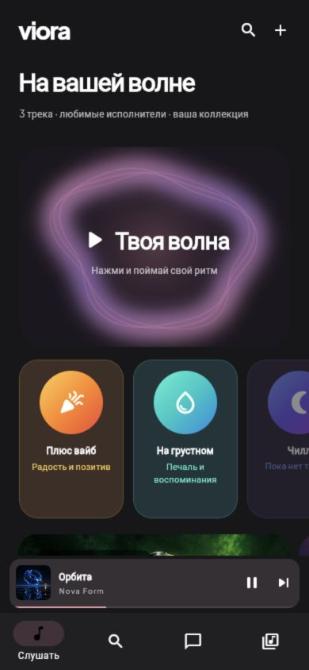

# Viora

Flutter-приложение для личной музыкальной библиотеки: импорт собственных аудиофайлов, избранное, очередь и фоновое воспроизведение. В исходниках есть подборки по настроению, избранные фрагменты, моменты и отдельный социальный сервис на Python/SQLite.

**Статус:** активная локальная разработка, публичный снимок исходников. Доступность в App Store не заявляется.

[English and setup](README.md) · [Портфолио](https://dobropalm.tech/ru/#viora)

## Интерфейс

[Экран плеера](docs/media/viora-player-demo.png). Снимки настоящего интерфейса с вымышленными треками, исполнителями и демонстрационными обложками. Прогресс 1:00 из 3:00 показан без аудио.

Музыку пользователь добавляет через системный выбор файлов. В нативном приложении копии сохраняются для офлайн-прослушивания. В браузере импорт действует в текущем сеансе. Поддержка кодеков зависит от платформы, защищённые DRM-записи не импортируются.

Для запуска: `flutter pub get`, затем `flutter run`. Социальный API по умолчанию не настроен. Для своего сервиса задайте `VIORA_API_BASE` и замените пример домена `viora.example.com` в настройках ссылок. Подпись iOS и доступы APNs предоставляются отдельно самим разработчиком.

Публичная копия не содержит аудио, обложек, текстов песен, каталога, названий и исполнителей личных треков, хешей библиотеки, анализа, истории прослушивания, бэкапов устройств, подписанных сборок, конфигурации боевого сервера и ключей. Прежняя Git-история не переносилась. Метаданные в тестах полностью вымышлены. Сохранены только оформление самого приложения и шрифты с их лицензиями.

Публичная ссылка на момент или музыкальную визитку передаёт выбранные пользователем данные его социальному сервису. Это отдельный сценарий от зашифрованных диалогов. Криптографический протокол и его ограничения описаны в [архитектуре](docs/architecture.md); независимый аудит криптографии не заявляется.

[Security](SECURITY.md). Публикация исходников не подтверждает доступность сервиса и не заменяет проверку приложения на устройстве. Дополнительная лицензия на исходники в этом снимке не предоставляется.
